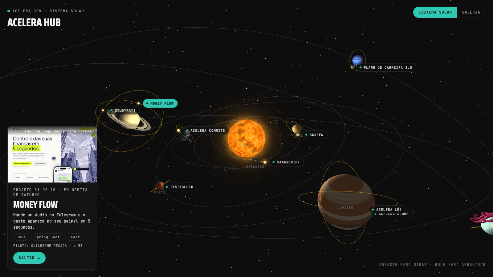
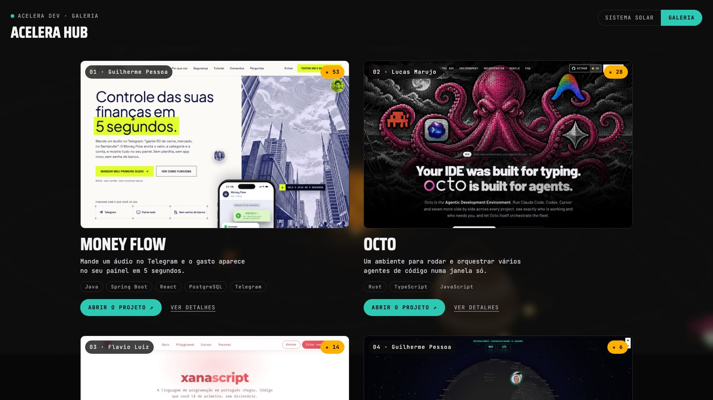

# Acelera Hub

A 3D solar system that lists the projects built by the Acelera Dev community. Each project is a star that orbits a planet.

Live at https://hub.aceleradev.com.br.



## What the page does

- The solar system view shows the Sun and eight planets. You drag to rotate and scroll to zoom.
- Clicking a project star flies the camera to it and opens a card with a screenshot, the main stack and the author.
- The "Saltar" button opens the project page: highlights, stack, a link to the project and the author's contacts.
- The gallery view lists the same projects as cards, ordered by GitHub stars.
- Uranus is reserved for Octo. A kraken sits on it.

The interface text is in Portuguese.



## How it is built

The site is one HTML file, `site/index.html`, with its CSS and JavaScript inline. There is no build step.

- Three.js r128 and OrbitControls load from a CDN.
- Planet textures are drawn on a canvas at load time. Earth uses two image files in `site/tex/`.
- Project screenshots are in `site/covers/`.
- The fonts are Saira Condensed and JetBrains Mono, from Google Fonts.

## Run it locally

```bash
git clone https://github.com/guithepc/hub-acelera.git
cd hub-acelera/site
python3 -m http.server 3178
```

Open http://localhost:3178. Opening `index.html` straight from disk does not work, because the browser blocks the Earth textures.

## Add a project

All project data is in the `projects` array in `site/index.html`.

1. Save a 1280 by 800 screenshot of the project as `site/covers/<name>.jpg`.
2. Add an entry to `projects`:

```js
{ name: "My Project", who: "Your Name", tag: "One sentence about what it does.",
  url: "https://my-project.com", shot: "covers/my-project.jpg",
  stack: ["React", "PostgreSQL"], host: "Marte", stars: 12, repo: "https://github.com/you/my-project",
  high: ["First highlight", "Second highlight", "Third highlight"] },
```

3. Add the author to the `crew` object, under the same name used in `who`:

```js
"Your Name": [["GitHub", "https://github.com/you"], ["LinkedIn", "https://www.linkedin.com/in/you"]],
```

Notes on the fields:

- `host` is the planet the star orbits: Mercúrio, Vênus, Terra, Marte, Júpiter, Saturno or Netuno. A planet can hold more than one project. Do not use Urano.
- `stars` and `repo` are optional. Leave them out when the repository is private or does not exist.
- `stars` is a fixed number, copied from GitHub by hand. The page does not update it.
- The gallery, the numbering and the arrow keys follow the order of `stars`, highest first.
- Publish only contacts the author already lists on a public profile.

## Deploy

The site runs as an nginx container behind Traefik. `deploy/site.Dockerfile` copies `site/` into the image.

On the server, inside the repository folder:

```bash
git pull
docker compose up -d --build
```

Compose reads these variables from a `.env` file in the same folder:

| Variable               | Purpose                                     | Default       |
| ---------------------- | ------------------------------------------- | ------------- |
| `HUB_DOMAIN`           | Public domain of the site. Required.        | none          |
| `TRAEFIK_NETWORK`      | External Docker network Traefik listens on. | `traefik`     |
| `TRAEFIK_ENTRYPOINT`   | Traefik HTTPS entrypoint.                   | `websecure`   |
| `TRAEFIK_CERTRESOLVER` | Traefik certificate resolver.               | `letsencrypt` |

Point the DNS record of the domain at the server before the first `docker compose up`. Traefik requests the certificate as soon as the container starts.

The site is unavailable for about 30 seconds after each deploy. Traefik waits for the first container health check, which runs 30 seconds after start.

To test the image on your machine without Traefik:

```bash
docker build -f deploy/site.Dockerfile -t hub-acelera:local .
docker run --rm -p 3300:80 hub-acelera:local
```

## The earlier Next.js version

The repository root still holds the first version of the site, a Next.js app with a project list and one page per project. The container no longer serves it. CI still lints, tests and builds it on every pull request.

To run it:

```bash
npm ci
npm run dev
```

Its project data is in `content/projects/` and its format is in `src/content/schema.ts`.

## Contributing

All work goes in through a pull request. A pull request is merged only when CI passes.

The plan and progress are tracked in Linear, in the "Hub Acelera" project.
